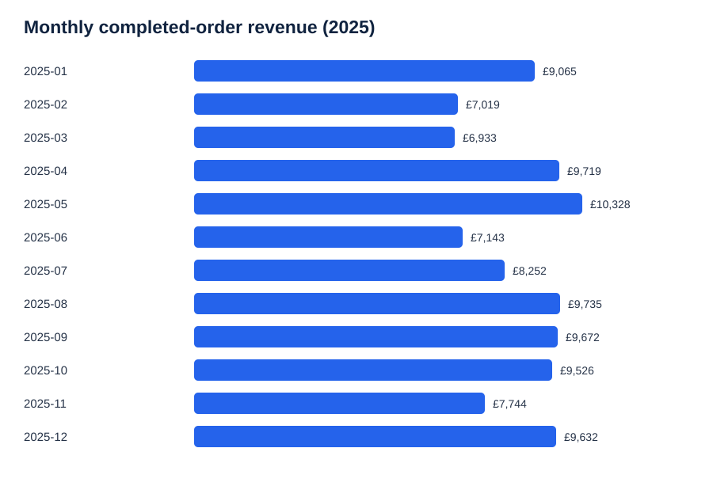
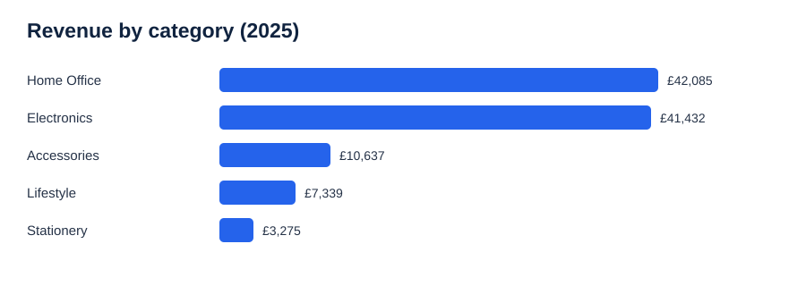

# E-commerce Sales Analysis | SQL + Data Visualisation

**Portfolio project | Synthetic dataset (not a real company's sales)**

## Business question
Which months, product categories, and UK regions contributed most to completed-order revenue in 2025?

## Data
- 1,200 fictional e-commerce orders, generated reproducibly using Python (fixed seed 20261019).
- Fields: date, product, category, region, quantity, unit price, discount, order status, order value.
- Revenue metric: sum of `order_value_gbp` **only where `order_status = 'Completed'`**. Returned and cancelled orders are excluded, and the dataset does not model refunds or net profit.

## Verified results
- Completed orders: **1,039**
- Completed-order revenue: **£104,768.45**
- Average completed order value: **£100.84**
- Highest revenue month: **2025-05**, £10,328.45
- Highest revenue category: **Home Office**, £42,084.65

## Charts

## SQL techniques demonstrated
`SELECT`, `WHERE`, `GROUP BY`, `ORDER BY`, `COUNT`, `SUM`, `AVG`, `ROUND`, date grouping, conditional filtering, and subqueries.

## Reproduce
1. Import `sales_data.csv` into a SQLite table named `sales` (column names match CSV headers).
2. Run the queries in `analysis.sql` in SQLite.
3. Results above were calculated directly from the included dataset.

## Interpretation and limitations
These figures describe a **simulated** retail dataset, not actual market demand. The strongest category and month are descriptive, not evidence of causation. A real business would also analyse cost, margins, refunds, acquisition channels and seasonality over multiple years before making decisions.

## Files
- `sales_data.csv` — synthetic source dataset
- `analysis.sql` — five reproducible analysis queries
- `monthly_revenue.svg` — revenue by month
- `category_revenue.svg` — revenue by category
